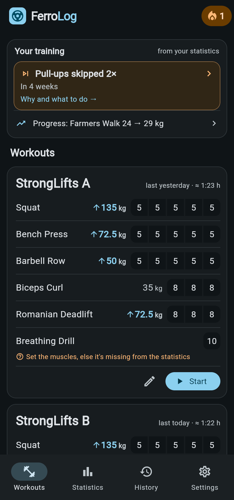
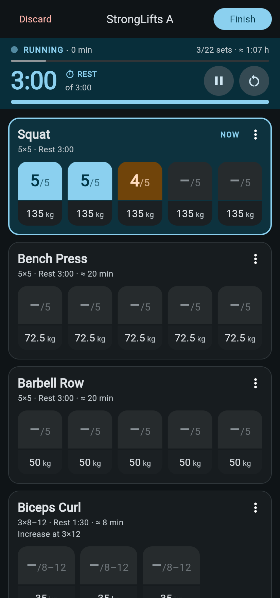
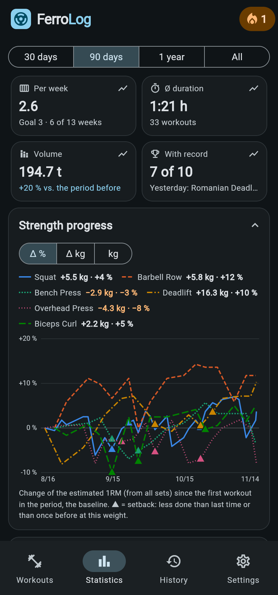
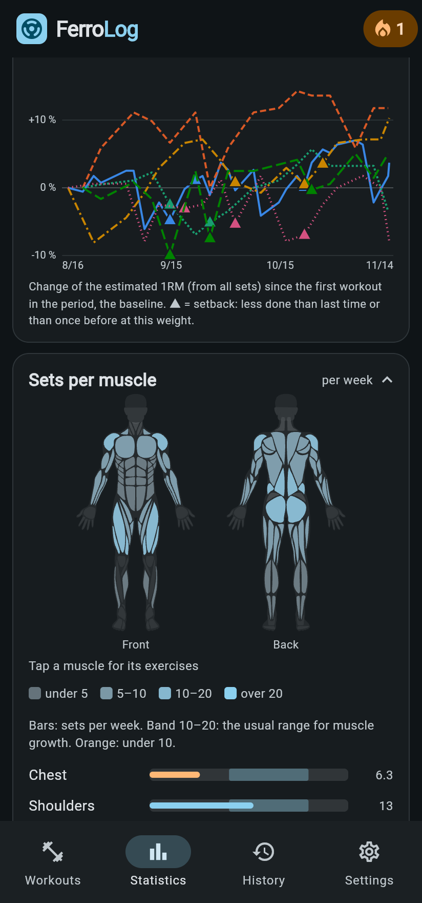
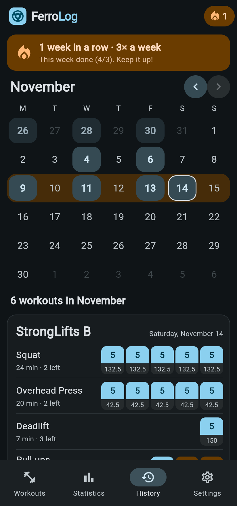

<p align="center">
  
</p>

<h1 align="center">FerroLog</h1>

<p align="center">
  <b>The strength training log that thinks along.</b><br>
  Plan workouts · log sessions live · understand your progress · refine it with AI
</p>

<p align="center">
  
  
  
  
</p>

<p align="center">
  
  
  
  
  
</p>

<p align="center"><sub>Screenshots in English from the built-in demo data; the app speaks German too.</sub></p>

---

## Why FerroLog?

Most training apps are forms: you type in numbers, and that's where they stay.
FerroLog closes the loop:

```
   Plan  ──►  Train  ──►  Analyze  ──►  AI review
    ▲                                       │
    └──────── updated plan back in app ◄────┘
```

- **It progresses for you.** After every workout FerroLog works out the weight for next time,
  in fixed steps or in **auto mode**, which adapts to your reps in reserve.
- **The statistics speak up.** Instead of you hunting through charts, the home card tells you
  what stands out and shows where it got that from.
- **Your data stays yours.** Everything is stored locally; optionally as one readable JSON file
  in your own private GitHub repo, ready for ChatGPT, Claude & co.

## Features

### 🏋️ Training
- **Live logging**: one tap per set, tap again to lower the reps, weight adjustable per set
- **Rest timer** that survives leaving the page and restarting the app
- **Remaining time and finish time** of the workout, estimated as you go
- **Warm-up sets** and a **plate calculator** (plates per side for barbell lifts)
- **Swap, add or skip exercises** during a workout without bending the plan
- **Reps in reserve (RIR)** after the last set, optional
- Android: workout shown **over the lock screen**, display stays on

### 📈 Progression
- **Progressive overload**: all sets done → the weight goes up in the plan
- **Rep ranges** (e.g. 3×8–12): reps first, then weight
- **Auto mode**: an adaptive share instead of fixed steps; a bad day doesn't count, and after a
  break you restart lighter ([details, German](docs/auto-modus.md))
- **Plateaus** are detected, telling a weight problem from fatigue

### 📊 Insights
- Key figures per period (30 days to all time): frequency, duration, volume, records
- **Strength progress** via estimated 1RM, with setbacks marked
- **Body map**: sets per muscle per week, against common hypertrophy guidelines
- **Balance check**: pressing vs. rowing, quads vs. hamstrings, abs vs. lower back and more
- **History** as a calendar with weekly streaks; edit past workouts afterwards and the plan
  recalculates

### 🤖 Data & AI
- **GitHub sync** via device flow: access to *one file* in *one* repo, nothing else
- **Export** via the share button, including a matching analysis prompt
- **AI plan import**: paste the plan the AI optimized, review the differences, apply
  ([details, German](docs/ki-plan.md))
- **Restore** from GitHub on a new device, asking on conflicts instead of silently overwriting

### ⚙️ Also
- Templates: StrongLifts 5×5, Starting Strength, Push/Pull/Legs, Upper/Lower, Full Body
- Custom exercises; rename and merge them **without losing their history**
- German and English, following the system language or picked in the settings
- kg or lb, preset by region
- Cardio, body weight, mood and tags per workout

## Quick start

```bash
flutter pub get
flutter run          # phone via USB
flutter test         # 23 test suites
```

### Try the demo

For presentations there is a demo with 1.5 years of realistic StrongLifts data
(holidays, sick weeks, plateaus, deloads …). It lives only in the demo server, never in the app:

```bash
flutter build web
python tool/demo_server.py 8091
```

Then open `http://localhost:8091`; `http://localhost:8091/?reset` reseeds the demo, `?reset&lang=en` reseeds it in English.

## Architecture

| Area | Files |
|---|---|
| Data model, progression, storage | [`model.dart`](lib/model.dart), [`loading.dart`](lib/loading.dart), [`units.dart`](lib/units.dart) |
| Workout & timer | [`session.dart`](lib/session.dart), [`timing.dart`](lib/timing.dart), [`recap.dart`](lib/recap.dart) |
| Statistics & findings | [`stats.dart`](lib/stats.dart), [`findings.dart`](lib/findings.dart), [`derived.dart`](lib/derived.dart), [`muscles.dart`](lib/muscles.dart), [`balance_card.dart`](lib/balance_card.dart) |
| Sync & AI | [`sync.dart`](lib/sync.dart), [`plan_import.dart`](lib/plan_import.dart) |
| Languages | [`language.dart`](lib/language.dart), [`l10n/app_de.arb`](lib/l10n/app_de.arb), [`l10n/app_en.arb`](lib/l10n/app_en.arb) (Flutter gen-l10n) |

Deliberately lean: Flutter with `shared_preferences`, `http` and a handful of plugins, no
state-management framework and no backend. Decisions and status of each feature are recorded in
[`docs/`](docs/) (German).

## Setting up GitHub sync

The app signs in as a GitHub App via device flow. The token can therefore only reach
the repos the user installed the app on.

<details>
<summary><b>Users: turn on sync</b></summary>

1. Create a private repo for the data, e.g. `ferrolog-data`, **with a README**
   (the API needs an existing `main` branch).
2. Install the GitHub App (`github.com/apps/<app-name>`) →
   *Only select repositories* → `ferrolog-data`.
3. In FerroLog: cloud icon → *Mit GitHub anmelden* (sign in with GitHub) → enter the code → pick the repo.

If the repo already holds a `ferrolog.json` that didn't come from this device (fresh install,
second phone, edited by hand or by an AI), the app won't overwrite it but asks:
*Von GitHub wiederherstellen* (restore from GitHub) or *GitHub überschreiben* (overwrite GitHub).
Restoring is also available any time under *Daten* (data).

</details>

<details>
<summary><b>Developers: register the GitHub App (once, for all users)</b></summary>

1. GitHub → Settings → Developer settings → GitHub Apps → **New GitHub App**
   - Name: globally unique, e.g. `Ferrolog Sync`; homepage URL: the project repo
   - Check **Enable Device Flow**, leave the callback URL empty
   - Uncheck **Expire user authorization tokens** (otherwise the sign-in expires after 8 h)
   - Webhook: uncheck **Active**
   - Permissions → Repository → **Single file: Read and write**, path `ferrolog.json`
     (Contents stays *No access*: the app can reach only this one file)
   - Installable by: **Any account**
2. Put the **Client ID** into `githubClientId` in `lib/sync.dart` (it's public and may be committed).

</details>

## Data format for AI

After every workout the app writes `ferrolog.json` to the GitHub repo
(settings: cloud icon at the top right) or exports it via the share button.

<details>
<summary><b>Example <code>ferrolog.json</code></b></summary>

```jsonc
{
  "app": "ferrolog", "version": 1, "units": "kg",
  "exportedAt": "2026-11-02T21:40:00.000",
  "workouts": [{                       // plans, holding the weight for the NEXT workout
    "id": "…", "name": "Push/Pull A",
    "exercises": [{ "name": "Kniebeuge", "weight": 110, "sets": 3, "reps": 5,
                    "increment": 2.5, "restSeconds": 180, "auto": true }]  // auto = auto mode instead of fixed steps
  }],
  "sessions": [{                       // completed workouts, newest first
    "id": "…", "workoutId": "…", "workoutName": "Push/Pull A",
    "date": "2026-10-30T18:12:00.000",
    "exercises": [{ "name": "Bankdrücken", "weight": 77.5, "targetReps": 5,
                    "reps": [5, 5, 3], "rir": 0,    // null = set not done; rir = reps left after the last set (if asked)
                    "backoff": 10, "progression": "miss" },  // auto mode: started 10 % lighter after a break; outcome
                  { "name": "Kabelrudern", "weight": 45, "targetReps": 10,
                    "reps": [10, 10, 9], "replaces": "Rudern" }]  // swapped during the workout; "added": true = added
  }]
}
```

</details>

**Progressive overload:** once all sets of an exercise are done, `weight` in the plan goes up
by `increment`. In auto mode it rises by a share of the weight that adapts itself and follows
the reps in reserve; steps that are too small are bridged with reps, a bad day
doesn't count, and after a break you restart lighter (see [`docs/auto-modus.md`](docs/auto-modus.md)).
